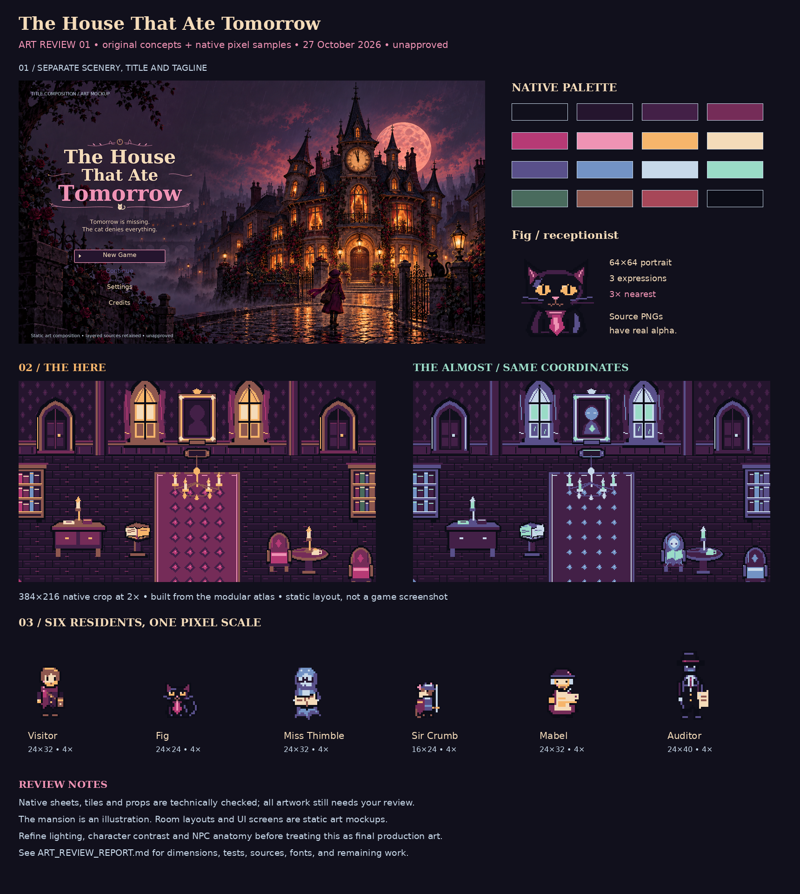
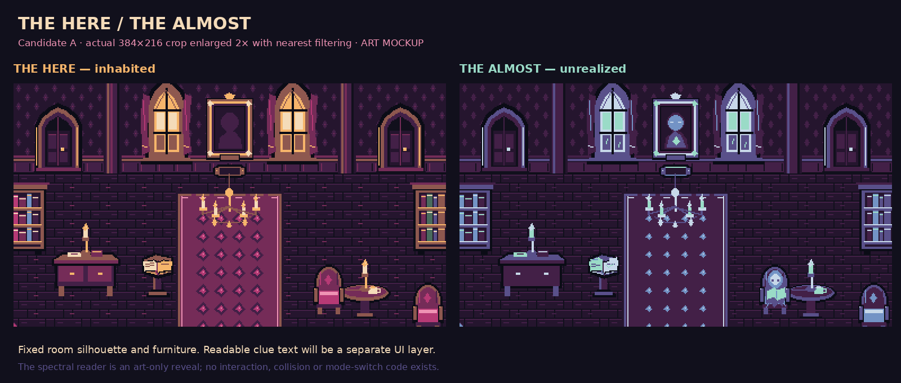

# Art review 01 — The House That Ate Tomorrow

**Delivered:** 27 October 2026  
**Decision:** UNAPPROVED — awaiting user review  
**Scope:** Original art samples and export tooling. Gameplay remains later work, as requested.

The repo is populated with the complete unchanged handoff and a new original art sample pack. Native art passes file and geometry checks. The pack is ready to review, with visual refinements disclosed below; it is not a finished game or a claim of final production art quality.

## Start with these previews





- [Two hall directions](art_staging/review/ENVIRONMENT_DIRECTIONS.png)
- [Visitor and Fig at 1×, 2× and 4×](art_staging/review/CHARACTER_PIXEL_SCALES.png) and [walk animation study](art_staging/review/CHARACTER_WALK_PREVIEW.gif)
- [Six-character lineup and portraits](art_staging/review/CHARACTER_LINEUP.png)
- [Atlas, repeat studies and clue props](art_staging/review/ENVIRONMENT_ATLAS_REVIEW.png)
- [UI components](art_staging/review/UI_COMPONENTS.png), [desktop dialogue](art_staging/review/UI_DIALOGUE_1366.png), [compact dialogue](art_staging/review/UI_DIALOGUE_960.png), and [compact notebook/inventory](art_staging/review/UI_NOTEBOOK_960.png)
- [Layered title/menu composition](art_staging/review/TITLE_MENU_COMPOSITION.png) and [palette](art_staging/review/ART_PALETTE.png)

## Delivered files

`READY FOR REVIEW` means the stated file checks pass, not human approval. `NEEDS REFINEMENT` identifies an intentionally unfinished visual direction.

| Deliverable | Status | Files and measurements |
| --- | --- | --- |
| Hall directions A/B, Here/Almost | READY FOR REVIEW | `art_staging/concept/HALL_{A,B}_{HERE,ALMOST}.png`, 512×352; corresponding `_VIEWPORT.png` files are 384×216. Two static placement JSON files reproduce all four rooms. |
| Modular foyer atlas | READY FOR REVIEW | `art_staging/tiles/foyer_atlas_here.png`, `foyer_atlas_almost.png`, and shared JSON; 256×256, 16×16 cells, 32 named objects, 140 indexed cells. Unused cells are transparent. |
| Visitor | READY FOR REVIEW | `art_staging/sprites/visitor_sheet.png` + JSON; 120×128, 24×32 cells, 20 frames: south/west/east/north rows, idle plus four walk columns. Foot anchor (12,30), 167ms walk frames. |
| Fig | READY FOR REVIEW | `fig_sheet.png` + JSON; 96×24, four 24×24 idle/blink/tail/talk poses. `fig_portraits.png` + JSON; 192×64, three 64×64 expressions. World foot anchor (12,22). |
| Cast lineup | NEEDS REFINEMENT | Six individual `art_staging/sprites/*_concept.png` files and metadata. Visitor/Thimble/Mabel 24×32, Fig 24×24, Crumb 16×24, Auditor 24×40. Other NPCs are single-pose studies. |
| Clue props | READY FOR REVIEW | `art_staging/props/guestbook_{here,almost}.png`, `nameplate_{here,almost}.png`, 32×16 each; `ghost_reader_almost.png`, 32×48; family metadata included. Nameplates stay blank for later readable text overlay. |
| UI kit | READY FOR REVIEW | `art_staging/ui/`: ten 24×24 icons and sheet, separate focus arrow, 48×48 dialogue panel, three 48×32 button states, 80×80 portrait frame. Sidecar JSON records 8px nine-slice margins and frame geometry. |
| UI samples | READY FOR REVIEW | Dialogue and notebook/inventory PNGs at 1366×768 and 960×540 under `art_staging/review/UI_*`. Static typography/layout studies only. |
| Editable title and tagline | READY FOR REVIEW | `art_staging/branding/title_wordmark.{svg,png}`, 1000×420; `title_tagline_lockup.{svg,png}`, 1000×90; matching `_outlined.svg` portable versions and JSON. Exact title capitalization and tagline verified. |
| Mansion/title composition | NEEDS REFINEMENT | `art_staging/concept/MANSION_TITLE_BACKGROUND.png`, 1672×941, text-free illustration; metadata records ImageGen provenance. `review/TITLE_MENU_COMPOSITION.{png,svg,json}` keeps scene, wordmark, tagline and menu labels separate. |
| Review and provenance | READY FOR REVIEW | `art_staging/manifest.csv`, `review/ART_VALIDATION.json`, palette/contact/comparison sheets, editable Python/SVG sources and folder documentation. |

## Recommended direction

**A — Candlelit Registry** is the recommended first-room direction. Its central runner, paired exits, north-wall portrait and nearby guestbook provide a clearer tutorial composition. B — Moonlit Reading Hall creates a more domestic reading corner and a stronger asymmetrical route; it is a useful alternate mood but spreads the first puzzle's points of interest farther apart.

The Here and Almost exports share one placement list per candidate. Architecture and furniture remain fixed. The Almost changes portrait content, shows an absent reader, lifts guestbook pages and adds ghost rain. These are visible shape changes as well as palette changes. The camera studies show the north-wall portrait and guestbook together; they do not establish camera behavior or navigation in a game.

## Validation results

The reproducible validator reports **PASS**, with seven check groups and no errors in `art_staging/review/ART_VALIDATION.json`. All six art scripts were rerun from outside the repository using bundled fonts; every existing visual export was byte-identical. The manifest records 67 visual/font files, and all 35 local links in the root review documents resolve.

- **33 native PNG exports:** nine character images, seven environment/prop images and 17 UI images. All decode as RGBA, use only the shared 16 colors where opaque, and contain true transparent pixels with alpha exactly 0 or 255. No checkerboard is baked into native exports.
- **Character sheets:** all 33 cells across the nine images have clear borders and documented geometry. Each Visitor direction has four distinct walk poses. A Fig tail touching the cell edge was corrected before final validation. The timing and feet anchors are documented; walking feel is not runtime-tested.
- **Atlas/layouts:** all object bounds align to 16px cells; 140 cell indices have no overlap. All four complete hall PNGs reconstruct exactly from the atlas and placement JSON. All four viewport crops match their recorded rectangle. Repeat samples were visually inspected; no Godot texture filtering/import test has occurred.
- **Palette and cohesion:** sprites, props, tiles and native UI share the exact written palette. The title illustration and antialiased typography are explicitly outside the strict native-pixel rule. The richly illustrated title and simpler in-room art still need stylistic refinement together.
- **Branding:** editable SVG text matches `The House That Ate Tomorrow` and `Tomorrow is missing. The cat denies everything.` exactly. Transparent PNGs are separate from the illustration. Outlined SVGs do not require a font installation.
- **Small-screen text:** rendered samples were visually inspected at 1366×768 and 960×540. Dialogue body text is 24/18px; notebook text is 22/18px; control captions are at least 16px. Measured paper-on-plum contrast is 12.80:1; focused paper-on-wine text is 6.95:1. Focus has both an arrow and border. These are static checks, not browser or keyboard accessibility acceptance.
- **Provenance:** the new manifest covers every generated visual/font file with a source and SHA-256 hash. All 21 supplied handoff checksums still pass. Original specifications and their unsigned approval checklist are unchanged.

## Three strengths and three remaining risks

1. **Reusable native assets:** the sheets, transparent props and modular atlas have real native dimensions, exact colors and reconstruction metadata.
2. **Readable before/after:** the same room anchors survive the mode change, while new silhouettes and clue details make the difference visible.
3. **Editable presentation:** title, tagline and background remain independent; UI body text is readable at compact size and font licenses are included.

1. **Lighting and contrast need refinement.** Here has warm windows but limited localized candlelight. Dark character limbs can blend with plum floors. Review these in a future moving room before final art signoff.
2. **NPC detail is preliminary.** Thimble, Crumb, Mabel and Auditor are static scale studies. They need richer anatomy, expression/directional sets and more personality. The Visitor's walk is deliberately restrained and may need stronger motion.
3. **The title is conceptual.** The mansion is an illustration, not native layered pixel scenery. Its clock suggests near midnight, but the exact 11:59 hand angles need final production review. The font-backed wordmark is readable and editable; a more bespoke drawn treatment remains an optional art refinement.

No game source, scenes, collision maps, build workflows, exports or deployment were created. No engine/runtime screenshots are claimed. The older `Innate` repo and private vault were not accessed; their historical claims remain unverified.

## Provenance and rights

Native assets were authored as original pixel geometry by Codex, with editable art scripts retained. No supplied concept pixels were cropped into production sheets and no third-party game art packs were used. The mansion illustration was generated and refined with OpenAI ImageGen; its metadata identifies the saved source and brief.

Branding and UI use unchanged DejaVu fonts, with notices in `art_staging/branding/fonts/LICENSE-DejaVu.txt`. SVG paths preserve portable wordmark/tagline outlines. No blanket public license or commercial title clearance is asserted for the project. The new files remain staged art awaiting review.

## Reproduce the exports

Use Python 3 with Pillow and fontTools; versions used were Pillow 12.3.0 and fontTools 4.61.1. Dependency ranges are recorded in `art_staging/source/requirements.txt`. These commands author/export art only:

```sh
python art_staging/source/draw_characters.py
python art_staging/source/draw_environment.py
python art_staging/source/draw_branding.py
python art_staging/source/draw_ui.py
python art_staging/source/build_review.py
python art_staging/source/validate_art.py
sha256sum -c PACKAGE_FILES_SHA256.txt
```

The ImageGen illustration is a preserved source file; re-exporting the pack does not call an image service. All typography sources and art helper review labels use the bundled DejaVu fonts. The supplied checklist remains unsigned. Review these files, request changes, or explicitly approve the art before authorizing a first playable slice.
